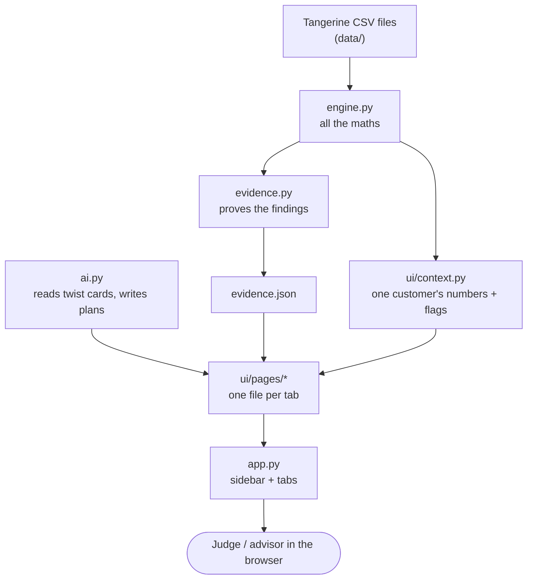

# Architecture: the tech, and how everything works

This explains how Runway is built, in plain language first and technical detail second. If you only read one section, read "The big picture".

---

## 1. The big picture

Runway has **four layers**. Data flows down; nothing flows back up.

| Layer | Files | Its one job | Owner |
|---|---|---|---|
| **Data** | `data/*.csv` | The bank data Tangerine gave us. Never committed. | n/a |
| **Engine** | `engine.py` | Every calculation: runways, the warning score, simulations, plans. | Engine lead |
| **Evidence + AI** | `evidence.py`, `ai.py` | Proving the findings; reading and writing plain English. | Engine lead / AI owner |
| **App** | `app.py`, `ui/` | Showing it: charts, buttons, layout. No maths. | Frontend owners |

**The golden rule:** the app layer *never* calculates money. That keeps one version of every formula, and the tests check that version.

## 2. What happens when someone clicks

Say a judge types account `93172` and the twist card "laid off, EI 55% for 6 months":

1. **`app.py`** reads the account number and the slider values from the sidebar and Shock tab.
2. **`ui/state.py`** turns the slider values into a `Scenario`: job loss, EI 55%, 6 months.
3. **`ui/context.py`** asks `engine.py` for everything about this customer, once:
   - the judges' numbers (`profile`, `runway`)
   - our realistic numbers (`realistic_profile`, `realistic_runway`)
   - the warning score (`liquidity_trough`)
   - the loan view (`loan_risk`)
   - 2,000 simulated futures (`simulate`)
   - plain-English flags (e.g. "Loan granted while already overdrawn")
4. **Each page in `ui/pages/`** draws its tab from that context.
5. **`ai.py`** only runs when someone presses "Read card" or "Write the plan".

Slow things (anything over all 4,500 accounts, like the watchlist) are computed once and cached in `ui/data.py`, so every click stays under a second.

## 3. Tech stack

| Need | Tool | Why |
|---|---|---|
| Language | Python 3.11+ | Everyone knows it; all the maths libraries are here |
| Data tables | pandas, NumPy | Fast per-customer calculations over 185k monthly rows |
| Optimisation | SciPy `linprog` (HiGHS solver) | Finds the cheapest monthly cuts that avoid overdraft |
| Statistics | scikit-learn (AUC), statsmodels | Testing how well our warning score predicts trouble |
| Web app | Streamlit | A web app in pure Python, no JavaScript needed |
| Charts | Plotly | Interactive charts |
| AI | Google Gemini via `google-genai` (Vertex AI or API key) | Reads twist cards, writes plans; offline fallback built in |
| Tests | pytest + Streamlit `AppTest` | Proves the numbers; clicks through the app automatically |
| Code | GitHub | Required for submission; how we collaborate |

## 4. The data, simply

Tangerine gave us **real but anonymized data from a Czech bank in the 1990s**, with dates moved to 2020–2025 and money in Canadian dollars. It is **not** real Tangerine customers.

| File | One row is | We use it for |
|---|---|---|
| `monthly_summary.csv` | one account, one month | almost everything (the judges use this too) |
| `transactions.csv` | one transaction | detail (not needed by the app) |
| `loans.csv` | one loan | loan payment, loan outcome (repaid or defaulted) |
| `clients.csv` + `dispositions.csv` | one person / link to an account | owner age, joint accounts |
| `districts.csv` | one region | context only (it's the original Czech data) |

Quirks that shape our design:
- **Mostly cash.** About 75% of money in is cash deposits, so "money in" is not the same as pay. We say "money in" and "money out".
- **Thin labels.** Half of all transactions have no purpose label.
- **16% of accounts are pensioners,** and 57 owners are under 18.

## 5. How each part works (plain English → the maths)

### 5.1 The judges' runway (`profile`, `runway`)
*Plain:* "If more goes out than comes in, how many months until savings run out?" This is the exact formula from the Tangerine README, so our live numbers match the judges' answer sheet.

*Maths:*

| Symbol | Definition |
|---|---|
| I | median money in |
| S | median money out |
| B | mean of the average daily balance over the last 6 months |
| H | median household bills |

Runway = (B − one-off costs) ÷ (money out after shock − money in after shock). It's 0 if savings are gone, "no shortfall (120+)" if nothing is lost each month, capped at 120, rounded to 1 decimal.

### 5.2 Our realistic runway (`realistic_profile`, `realistic_runway`)
*Plain:* the same question, fixing five things the standard formula gets wrong:
1. **Recent averages, not lifetime medians.** Medians call 26% of customers "spending more than they earn" when almost all of them are actually ending up with more money.
2. **Pensions keep coming after a layoff.** The standard formula cuts a retiree's pension to 55%.
3. **EI is capped at $729 a week** (2026), so high earners get less than 55%.
4. **EI stops after 6 months.** The standard formula pays it forever.
5. **The balance dips within each month,** so not all savings are really usable.

### 5.3 The warning score: Liquidity Trough Ratio (`ltr_table`, `liquidity_trough`, `watchlist`)
*Plain:* "How close does this customer's balance get to zero, compared to normal?" Lowest balance in the last 6 months ÷ average balance. A low number means they keep dipping near $0 even if the average looks fine.

*Rules:* only scored with 12+ months of history (a new account's first month fakes a deep dip). The riskiest 10% are flagged.

*Time Machine:* the same score calculated using only data up to Dec 2023 or Dec 2024, then compared with what really happened next.

### 5.4 Credit view and bank view (`loan_risk`, `portfolio_curve`)
- **Credit view:** for borrowers, the loan, the payment as a share of money in, the warning score *before* the loan, and the outcome.
- **Bank view:** if one shock hit every customer at once, what share would still have money each month? Standard formula vs realistic.

### 5.5 Signal vs noise: Kalman filter (`kalman_level`, `net_flow_filter`)
*Plain:* monthly money in minus money out jumps around a lot. The filter draws the steady line underneath, with an uncertainty band.

*Maths:* a local-level state-space model; how smooth the line is gets chosen by maximum likelihood.

### 5.6 "Do they make it?": Monte Carlo simulation (`simulate`)
*Plain:* we create 2,000 possible futures by replaying random 3-month chunks of the customer's own last 24 months, apply the shock to each, and count how many run out.

*Outputs:*
- a range band (bad 10%, typical, good 10%)
- the chance of making it 6 and 12 months
- the bank's expected overdraft

Same customer plus same shock always gives the same answer (seeded).

### 5.7 Smallest cuts: optimiser (`optimize_cuts`)
*Plain:* "What's the least they can cut each month and never go below zero?" Bills and insurance are never cut.

*Maths:* a linear program solved with SciPy HiGHS. It minimises total cuts subject to the projected balance staying above the overdraft line every month.

### 5.8 The plan (`make_plan`)
- **Goal:** milestones toward surviving 6 months of a layoff (starter, 3 months, 6 months), with how many months each takes.
- **Backup:** actions ranked by how many extra months each one buys.

### 5.9 AI (`ai.py`)
*What it does:*
- turns the judge's sentence into shock settings, shown as chips before anything runs
- writes the plan in plain English

*What it never does:* calculate. Every number in AI-written text is checked against the engine's numbers. If any number doesn't match, we show a template instead.

*Fallback:* if the AI is unavailable, rule-based parsing still reads the cards.

## 6. Function contract (don't rename without telling everyone)

| Function in `engine.py` | Gives you | Used by |
|---|---|---|
| `load()` | the data | everything |
| `profile`, `runway`, `all_profiles`, `runway_vec` | judges' numbers | Know, Shock, Watchlist |
| `realistic_profile`, `realistic_runway`, `realistic_runway_vec`, `Scenario`, `explain_difference` | our numbers + reasons | Know, Shock, Plan |
| `ltr_table`, `liquidity_trough`, `watchlist`, `what_happened_next` | warning score, Time Machine | Watchlist, Know |
| `loan_risk`, `portfolio_curve` | credit view, bank view | Know, Watchlist |
| `net_flow_filter` | Kalman line | Know |
| `simulate` | 2,000 futures | Shock, Plan |
| `optimize_cuts`, `make_plan` | plans | Plan |

| Function in `ai.py` | Gives you |
|---|---|
| `init()` | which AI is active |
| `parse_twist(text)` | shock settings + "AI" or "rules" |
| `write_plan(facts)` | plan text + who wrote it |
| `verify_numbers(text, facts)` | True if every number is real |

| In `ui/` | Gives you |
|---|---|
| `context.build_context(...)` | a `Context` with everything one customer needs: `c.p`, `c.r`, `c.key_res`, `c.real_res`, `c.lt`, `c.LR`, `c.sim`, `c.flags`, … |
| `data.load_all()`, `data.wl()`, `data.pcurve()`, `data.trough_table()` | cached loaders |
| `state.scenario()`, `read_card`, `preset`, `reset` | slider state and button callbacks |
| `style.INK / ORANGE / SLATE`, `style.flags_html()` | colours (orange = ours, grey = standard) |

**A page is just:** `def render(c): ...` using only `c` and the helpers above.

## 7. Testing

| Test | Checks | Run it when |
|---|---|---|
| `tests/test_acceptance.py` | 34 engine checks with numbers verified on the real data (e.g. account 20111's runway is 3.4; 93172's trough rank) | Always, before every PR |
| `tests/test_app_smoke.py` | Clicks every preset, the Time Machine, tricky accounts and random accounts; fails on any error | You touched `app.py` or `ui/` |
| `pytest -m slow` | Re-runs the statistical evidence | You touched `engine.py` or `evidence.py` |

## 8. Performance

- **Data loads once** (cached): about 2 seconds at app start.
- **Watchlist and bank view:** about 0.5 seconds, cached per date and per scenario.
- **One customer:** the simulation takes about 10 ms; one click takes well under a second.
- **Rule:** never loop over all 4,500 accounts inside a page. Add a cached, vectorised function instead.
