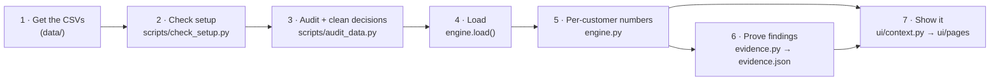

# Data pipeline: from raw files to every number on screen

This is the step-by-step path the data takes, which tool does what at each step, and how to add a new calculation safely.



---

## Step 1 · Get the data

1. Download the Tangerine folder from the event Drive.
2. Copy the CSVs into `runway/data/`:
   ```
   data/monthly_summary.csv   data/loans.csv          data/accounts.csv
   data/clients.csv           data/dispositions.csv   data/cards.csv
   data/standing_orders.csv   data/districts.csv      data/transactions.csv (optional, 100 MB)
   ```
3. If you keep the data elsewhere, run `export RUNWAY_DATA=/path/to/folder` (on Windows PowerShell: `$env:RUNWAY_DATA="C:\path"`).

**Never commit `data/`.** `.gitignore` already blocks it. Check with `git status` before every commit.

## Step 2 · Check your setup

```bash
python scripts/check_setup.py
```

It checks your Python version, packages, every CSV and its row count, Git safety, and that the engine reproduces the judges' answer for one account (20111 → 3.4 months). Every problem comes with the exact fix.

## Step 3 · Audit the data, and the "cleaning" decisions

```bash
python scripts/audit_data.py      # prints the report and writes docs/DATA_AUDIT.md
```

**Good news: the data needs no row-level cleaning.** The files the app uses have no missing values, the money columns add up exactly, and every ID links up. The audit proves this with 10 integrity checks.

The real cleaning work is **deciding how to treat each quirk**. Those decisions are coded in `engine.py` and listed in `docs/DATA_AUDIT.md`:

| Quirk | What we do |
|---|---|
| Czech 1990s data, re-dated and converted to CAD | Say so; use Canadian sources only for shock sizes (the EI cap) |
| 75% of money in is cash deposits | Say "money in", not income; the pay share is a slider |
| 51% of transactions have no purpose | Call those outflows "purpose unknown" |
| 1,225 accounts have no labelled bills | Flag it; a bills shock does nothing to their standard runway |
| Opening balance ≈ 2% of the next months' average | Only score the trough with 12+ months of history |
| 740 pensioners, 57 owners under 18 | Pension protected in a layoff; both flagged |
| 76 accounts with no recent activity | "No activity after YYYY-MM", never "closed" |
| District unemployment 2022 vs 2023 correlate 0.98 | Not used |
| Defaults have no dates | Use only signals measured *before* the loan |

**Judges score "cleaned and questioned the data" (Data Use, 25%).** `docs/DATA_AUDIT.md` is the evidence; mention it in the write-up.

## Step 4 · Load (`engine.load()`)

**Tool: pandas.**
- `monthly_summary.csv` is sorted by account and month. Months stay as `"YYYY-MM"` text, which sorts and compares correctly.
- `loans.csv`:
  - `loan_start` is parsed as a date
  - `loan_end` = start + duration in months
  - `running_end_2025` = loan_end after 2025-12-31 (the audit proves this equals statuses C and D)

In the app, `ui/data.py` wraps this in `st.cache_resource`, so it loads **once** (about 2 seconds) and is reused on every click.

## Step 5 · Per-customer numbers (`engine.py`)

All of these work from `monthly_summary.csv`, one customer at a time (or all at once, vectorised).

| What | How (plain) | Tool |
|---|---|---|
| **Judges' numbers** (I, F, S, B, H, P) | medians of the customer's months; buffer = average of the last 6 months | pandas `groupby` + `median` |
| **Standard runway** | (savings − one-offs) ÷ (money out − money in after the shock), README rules | plain Python / NumPy |
| **Realistic runway** | last-12-month averages, pension kept, EI capped at $729/week and ending after 6 months, minus the monthly dip | pandas + NumPy |
| **Trough ratio** | lowest balance ÷ average balance, last 6 months; ranked across customers | pandas `groupby` + `rank` |
| **Watchlist** | the trough for every customer + reasons, sorted | pandas, vectorised |
| **Credit view** | the loan, plus the trough in the 6 months before the loan | pandas |
| **Kalman filter** | steady line under noisy monthly net flow | NumPy (our own ~30 lines) |
| **Monte Carlo** | 2,000 futures from 3-month chunks of the customer's last 24 months | NumPy random (seeded) |
| **Optimiser** | smallest monthly cuts that keep the balance above the overdraft line | SciPy `linprog` (HiGHS) |
| **Plan** | milestones and backup actions from the realistic numbers | plain Python |
| **Bank view** | realistic and standard runway for all 4,500 customers → share still above zero each month | pandas, vectorised |

## Step 6 · Prove the findings (`evidence.py`)

```bash
python evidence.py      # ~1-2 minutes → evidence.json
```

| Finding | Method | Tool |
|---|---|---|
| Trough predicts first overdrafts | Out-of-time: data up to Dec of year N, outcome in year N+1, for 2023/2024/2025 | pandas + scikit-learn `roc_auc_score` |
| How sure we are | Bootstrap: resample customers 1,000 times | NumPy |
| Risk ratio interval | log(RR) ± 1.96 × SE | NumPy |
| Overdraft vs loan default | Crosstab + Fisher exact test | pandas + SciPy `fisher_exact` |
| Pre-loan signal | Trough measured before each loan vs default | scikit-learn |
| Formula blind spots | Counts across all customers (EI ending, pensioners, …) | pandas |
| Multiple testing (task E3) | Benjamini–Hochberg | statsmodels |
| Confounders (task E4) | Logistic regression with controls | statsmodels |

`tests/test_acceptance.py` pins the key numbers, so if anything changes them by accident, a test fails.

## Step 7 · Show it (`ui/`)

1. `ui/state.py` turns the sliders into a `Scenario`.
2. `ui/context.py` calls the engine **once per click** and packs everything into `c` (`c.p`, `c.r`, `c.key_res`, `c.real_res`, `c.lt`, `c.LR`, `c.sim`, `c.flags`, …).
3. Each page in `ui/pages/` draws from `c` with **Streamlit** (layout, widgets) and **Plotly** (charts).
4. `ai.py` (Gemini, or offline rules) only reads twist cards and writes the plan text; its numbers are verified.

## How to add a new calculation (the safe way)

Say the Plan page wants "months of savings at the customer's worst month":

1. **P3 asks P1:** "engine: I need `worst_month_cover(acct, d) -> float` for the Plan page."
2. **P1 adds it to `engine.py`** with a docstring explaining the formula.
3. **P1 adds a test** in `tests/test_acceptance.py` with a hand-checked number for one account.
4. **P1 runs `pytest -q`** and merges.
5. **P3 calls it in `ui/pages/plan.py`** and only formats it for display.
6. **P3 runs `pytest -q -m ui`** and opens a PR.

If you're using Claude Code, step 2's prompt is: *"Read CLAUDE.md. Add `worst_month_cover(acct, d)` to engine.py: <definition>. Add a test with a value you verify by hand for account 20111. Run pytest -q."*

## Where each tool is used (summary)

| Tool | Used in | For |
|---|---|---|
| pandas | engine.py, evidence.py, scripts/ | loading, grouping per customer, all tables |
| NumPy | engine.py, evidence.py | vectorised maths, Kalman, Monte Carlo, bootstrap |
| SciPy | engine.py (`linprog`), evidence.py (`fisher_exact`) | optimiser, exact test |
| scikit-learn | evidence.py, tests | AUC (how well a score ranks risk) |
| statsmodels | evidence.py (tasks E3, E4) | Benjamini–Hochberg, logistic regression |
| Streamlit | app.py, ui/ | the web app, caching, widgets |
| Plotly | ui/pages/ | charts |
| google-genai | ai.py | Gemini: twist-card reading, plan wording |
| pytest | tests/ | proving numbers and clicking through the app |
